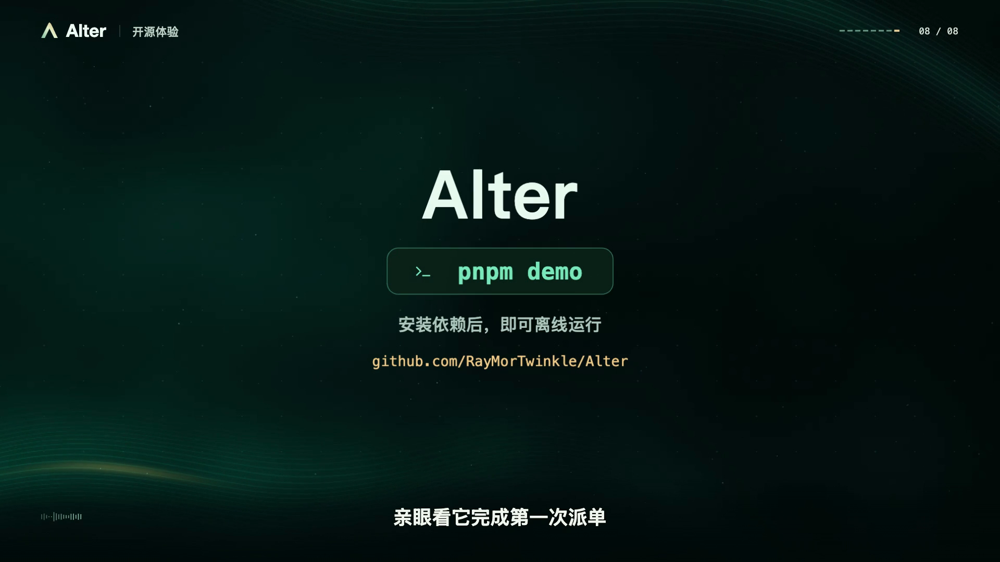
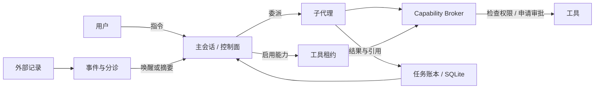

<div align="center">

# ✦ Alter

**事情太多，注意力只有一份。让 Alter 帮你盯着，让你把时间留给真正重要的事。**

主动的个人 AI 助手 · 在一个主会话里安排、委派、回看进展

[](package.json)
[](package.json)
[](LICENSE)
[](https://raymortwinkle.github.io/Alter/)
[](https://raymortwinkle.github.io/Alter/media/alter-demo.mp4)
[](https://github.com/RayMorTwinkle/Alter)

[✨ 在线交互体验站](https://raymortwinkle.github.io/Alter/) · [🎬 观看中文宣传片](https://raymortwinkle.github.io/Alter/media/alter-demo.mp4) · [🚀 3 分钟上手](#quickstart) · [📊 实测对比](#benchmarks) · [🏗️ 核心架构](#architecture)

<a href="https://raymortwinkle.github.io/Alter/media/alter-demo.mp4"></a>

**▶ 点击封面观看中文宣传片** · [打开交互式项目展示站](https://raymortwinkle.github.io/Alter/)

<video controls width="100%" poster="docs/media/alter-poster.jpg">
  <source src="https://raymortwinkle.github.io/Alter/media/alter-demo.mp4" type="video/mp4">
  你的浏览器不支持视频播放，请使用上方宣传片链接。
</video>

<sub>GitHub README 可能不显示内嵌播放器；点击封面或宣传片链接即可观看。</sub>

<table>
  <tr>
    <td align="center"><br><b>📊 固定样本回放，改进看得见</b></td>
    <td align="center"><br><b>🚀 一条命令，体验离线派单</b></td>
  </tr>
</table>

[English](README_EN.md) · [贡献指南](CONTRIBUTING.md)

</div>

## 💡 为什么做它？

📬 日程、消息和待办散落在各处，真正耗费心力的，常常是记得回去查看。Alter 想做一个主动的个人 AI 助手：你在同一个会话里交代事情，它可以派出子代理处理耗时任务，也可以按目标巡检，把需要你关注的事提醒出来。🔔

## ✨ 核心亮点

- 🧭 **一个主会话，持续跟进**：安排日程、交代后续事项、询问进展，任务结果和审批记录随会话保存。
- 🤝 **耗时工作交给子代理**：主会话负责调度，独立工作会话完成任务并带回结果与引用。
- 🔔 **主动提醒，也懂得收拢消息**：日程、定时任务和盯梢可以唤醒主会话；消息可分流为立即提醒、摘要或静默，并结合安静时段。
- 🔐 **工具调用有授权边界**：工具租约限定可用能力，调用时由 Capability Broker 检查权限；需要授权时可以挂起，等待你决定。
- 🧩 **按需连接能力**：仓库包含日历、邮箱、飞书、浏览器和订阅来源插件，以及 Web 和终端入口。
- 🧪 **离线体验真实任务流程**：脚本模型驱动主会话和子代理，读取本地笔记，并检查任务账本；依赖就绪后无需模型或外部账号凭据。

<a name="architecture"></a>

## 🏗️ 工作原理



外部内容与已验证用户的指令有不同来源；工具调用另有权限检查。审批可按一次、租约或任务、长期能力等范围授权，能力级授权可能覆盖该能力的不可逆动作。模型仍会接触不可信文本，这些设计不能保证全面抵御提示注入。详见 [入口与连接器](docs/adr/0003-surface-vs-connector.md)、[派单与租约](docs/adr/0002-main-session-control-plane-and-leases.md) 和 [审批规则](docs/adr/0021-permission-loosening.md)。

<a name="benchmarks"></a>

## 📊 实测改善（Before vs After）

同一组固定输入，在基线和重构后的代码上离线回放：

| 工作负载 · 观察量 | Before | After |
|---|---:|---:|
| 200 条历史消息、256 次累积文本更新 · 历史消息 ID 读取 | 51,200 次 | **200 次** |
| 同一草稿完整重放 32 次 · 返回新状态对象 | 32 次 | **0 次** |
| 顺序追加 200 条消息 · 时间戳读取 | 39,800 次 | **398 次** |
| 7 个固定日历样例 · 下一次触发时刻符合预期 | 5/7 | **7/7** |

<details>
<summary>🔎 展开查看测量口径与限制</summary>

这些数字是固定样本上的 JavaScript getter 调用、对象身份和时间结果，并非浏览器帧率、用户等待时间或线上通知送达率。两个日历失败样例共享同一个缺失星期五的根因。基线为 `backup1126` 的 `9dcd6c1`，修复后回放读取 `refactor/1126` 的 `132cae3` 源文件；环境、原始数据及复现命令见[完整评测报告](docs/evals/refactor-1126-report.md)。

同一断网 Linux arm64 镜像的全仓验证中，测试从 555/555 到 561/561，两版类型检查与 Web 构建均通过。macOS 默认并发下两版均出现测试失败，原因不能由现有日志唯一确定；详情也保留在报告中。

</details>

<a name="quickstart"></a>

## 🚀 3 分钟本地跑起来

准备 **Node.js 24** 和 **pnpm 11**，进入仓库后运行：

```sh
pnpm install --frozen-lockfile
pnpm demo
```

终端里会展示一次真实运行时的派单：主会话让工作会话读取本地笔记，再核对回执、任务状态和最终答复。首次安装需要访问包仓库或已有缓存；依赖就绪后可离线重复运行，无需模型、飞书或邮箱凭据。

<details>
<summary>🌐 想启动连接真实模型的 Web 应用？</summary>

先在本机副本的 `.env` 中配置模型网关和 Web 登录密码；外部账号按需启用。

```sh
cp .env.example .env
# 编辑 .env 后构建并启动
pnpm -C packages/web build
pnpm -C packages/server start
```

也可以用 `pnpm -C packages/core chat` 进入终端会话。工作区测试与类型检查分别使用 `pnpm test` 和 `pnpm typecheck`。

</details>

## 📚 延伸阅读 & 许可

- ✨ [在线交互体验站](https://raymortwinkle.github.io/Alter/) · 🎬 [中文宣传片](https://raymortwinkle.github.io/Alter/media/alter-demo.mp4)
- 📊 [完整评测报告与复现记录](docs/evals/refactor-1126-report.md) · [真实模型评测](docs/evals/2026-11-22-e2e.md) · [分诊评测](docs/evals/2026-11-22-triage.md) · [提示注入评测](docs/evals/2026-11-22-injection.md)
- 🏗️ [架构总览](docs/architecture/overview.md) · [决策记录](docs/adr/) · [路线图](docs/roadmap.md) · [贡献指南](CONTRIBUTING.md)
- 💚 [Ray 的个人主页](https://raymor.top) · [MIT License](LICENSE)

<div align="center">

如果 Alter 的方向让你有所共鸣，欢迎点一颗 ⭐，一起把它变得更好。

</div>
