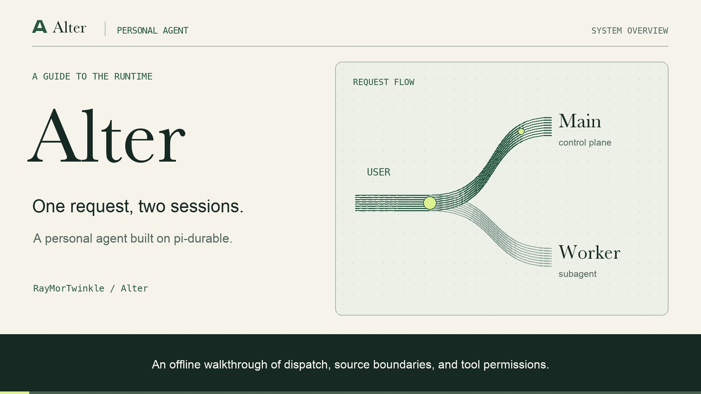
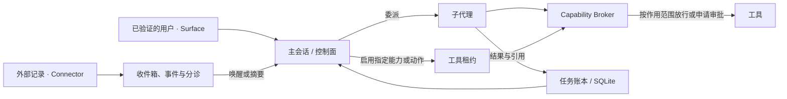

# Alter

[English](README_EN.md) · [项目导览](docs/index.html) · [演示视频](docs/media/alter-demo.mp4) · [本次评测与原始记录](docs/evals/refactor-1126-report.md)

Alter 是一个主动的个人 AI 助手。你在同一个主会话里安排日程、交代后续事项、询问进展。耗时工作由子代理执行，需要授权的工具调用可以挂起，结果和审批记录随会话保存。它也能按目标巡检，把值得打断你的消息单独提醒，其余汇入摘要。

[](docs/media/alter-demo.mp4)

## 三分钟上手

准备 Node.js 24、pnpm 11，进入本仓库。首次安装需要能够访问包仓库或已有本地缓存。

```sh
pnpm install --frozen-lockfile
pnpm demo
```

演示在终端内运行。脚本模型驱动真实的 pi-durable 主会话和子代理，调用本地笔记工具，再检查任务账本。依赖就绪后可断网重复执行，无需模型、飞书或邮箱凭据。

如需启动连接真实模型的 Web 应用，请先在本机副本中配置模型网关和 Web 登录密码。外部账号按需启用。

```sh
cp .env.example .env
# 编辑 .env 后，构建界面并启动服务
pnpm -C packages/web build
pnpm -C packages/server start
```

默认在 `http://127.0.0.1:4317` 打开。也可用 `pnpm -C packages/core chat` 进入终端会话。

## 一条请求如何执行



- **指令入口。** 已验证的用户通过 Surface 给出指令。Connector 收到的邮件、消息与订阅更新带着外部数据的身份进入分诊。模型仍会接触不可信文本，实际工具调用另有审批边界。[入口决策](docs/adr/0003-surface-vs-connector.md)
- **执行方式。** 主会话保留对话与调度上下文。长任务可以派给独立子会话，短操作可以临时租用工具。租约决定可见的动作，broker 在每次调用时检查权限。[派单与租约](docs/adr/0002-main-session-control-plane-and-leases.md)
- **副作用与授权。** 能力声明 `read`、`write` 或 `irreversible`。审批参考近期用户原话、任务范围和已有授权。用户可以批准一次、在当前租约或任务内批准整个能力、长期批准该能力，或拒绝。能力级授权可能覆盖其不可逆动作。[现行审批规则](docs/adr/0021-permission-loosening.md)
- **主动工作。** 日程提醒、定时任务和盯梢可以唤醒主会话。消息按立即、摘要、静默分流，结合安静时段减少打断。Web 端可以查看巡检、记忆、统计与审批设置。[巡检与通知](docs/adr/0012-main-wakeups-watch-and-notify.md)

## 本次离线回归

同一组输入分别在 `backup1126` 与 `refactor/1126` 上执行。这里计数的是固定样本上的程序行为。

| 固定输入与观察量 | 基线 | 重构后 |
|---|---:|---:|
| 200 条已落定消息、256 个累计文本片段 · 历史消息 ID 读取次数 | 51,200 | 200 |
| 同一草稿完整内容重放 32 次 · reducer 返回新状态的次数 | 32 | 0 |
| 顺序追加 200 条消息 · 时间戳读取次数 | 39,800 | 398 |
| 7 个固定日历用例 · 下一次触发时刻符合预期 | 5/7 | 7/7 |

其中两条基线日历失败来自同一个缺失的周五，起算日期不同。流式计数来自纯 reducer，浏览器帧率、SSE 网络延迟与线上通知送达均未在这组实验中测量。

[复现命令、原始输出与适用范围](docs/evals/refactor-1126-report.md) · [原有真实模型评测记录](docs/evals/2026-11-22-e2e.md) · [分诊评测](docs/evals/2026-11-22-triage.md) · [提示注入评测](docs/evals/2026-11-22-injection.md)

## 源码导读

| 从哪里读 | 可以看到什么 |
|---|---|
| [core](packages/core/src) | pi-durable 适配、派单、租约、审批、账本和巡检 |
| [server](packages/server/src) / [web](packages/web/src) | REST 与 SSE、流式对话、设置与运行记录 |
| [plugin-sdk](packages/plugin-sdk) / [plugin-runtime](packages/plugin-runtime) | 能力与事件来源声明、插件生命周期 |
| [calendar](packages/plugin-calendar) / [mail](packages/plugin-mail) / [feishu](packages/plugin-feishu) / [browser](packages/plugin-browser) / [sources](packages/plugin-sources) | 本地日程、163 邮箱、飞书、浏览器与订阅来源 |
| [gateway](packages/gateway) / [node](packages/node) / [node-protocol](packages/node-protocol) / [adapters](packages/adapters) | 网关、本地执行节点、协议与工具适配器 |
| [evals](packages/evals) | 端到端任务、权限、提示注入与分诊样本 |

同一断网 Linux arm64 镜像中，全仓测试从基线的 555/555 通过，到本版的 561/561 通过，两版类型检查和 Web 构建也通过。macOS 默认并发下，两版均有一项本地适配器测试触及 2 秒期限。[运行环境与失败日志](docs/evals/refactor-1126-report.md)

运行工作区测试用 `pnpm test`，运行类型检查用 `pnpm typecheck`。历史 `eval:e2e`、`eval:triage` 等命令需要相应模型或服务配置。离线演示单独使用 `pnpm demo`。

## 静态项目页

本机可直接打开 `docs/index.html`，浏览架构图、展开基准说明或播放视频。如果在 GitHub Pages 发布，在仓库 Settings → Pages 选择包含本次改动的分支和 `/docs`。站点无需构建。启用并完成发布后可使用项目地址。[GitHub Pages 项目页](https://raymortwinkle.github.io/Alter/)

## 路线图与贡献

架构按 ADR 持续演进。路线图分别记录了主动提醒、插件宿主、长期记忆与回访的状态。提出新能力时，请写清它接收何种输入、会造成哪类副作用，以及失败后应当看到什么。[路线图](docs/roadmap.md) · [架构总览](docs/architecture/overview.md) · [决策记录](docs/adr/) · [贡献指南](CONTRIBUTING.md)

[MIT License](LICENSE)
