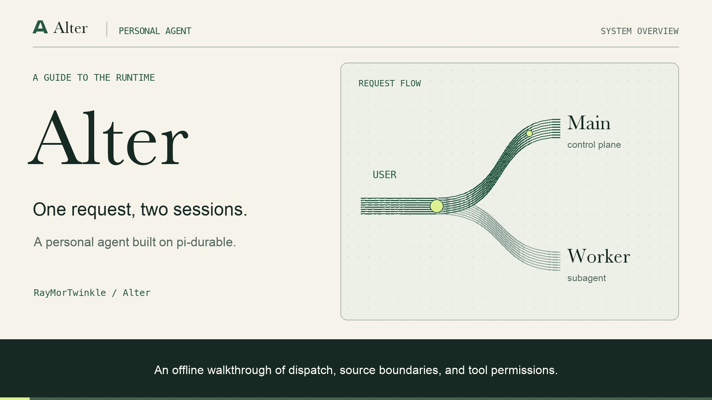
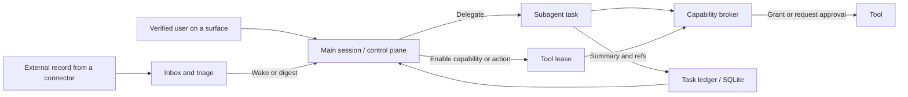

# Alter

[中文](README.md) · [Project tour](docs/index.html) · [Narrated demo](docs/media/alter-demo.mp4) · [Evaluation report](docs/evals/refactor-1126-report.md)

Alter is a proactive personal AI agent built on pi-durable. Give it a follow-up in one conversation, delegate the work, and come back to the result. Tasks can wait for approval, the runtime keeps a ledger, and incoming updates can wait for a digest or trigger a notification.

[](docs/media/alter-demo.mp4)

## Three-minute quickstart

From a checkout with Node.js 24 and pnpm 11, install the locked dependencies once. The install needs registry access or an existing package cache.

```sh
pnpm install --frozen-lockfile
pnpm demo
```

The command runs in your terminal. A scripted local model drives the real main session and subagent, uses a local notes tool, and checks the task ledger. Once installed, this path runs offline without a model account, messaging credentials or a running web server.

For the full web app, configure the model gateway and a local web password in your copy of the environment file. External accounts are optional.

```sh
cp .env.example .env
# Configure .env, then build the interface and start the server
pnpm -C packages/web build
pnpm -C packages/server start
```

Open `http://127.0.0.1:4317`. For a terminal session, use `pnpm -C packages/core chat`.

## From request to result



- **Authority follows the input path.** A verified user speaks through a surface. Connectors supply external records for triage. Those records can still influence a model, so the runtime also checks tool calls. [Surface and connector decision](docs/adr/0003-surface-vs-connector.md)
- **Delegate or lease.** The main session delegates multi-step work. For a short operation it can temporarily enable a capability or action. The broker checks the operation when called. [Control plane and leases](docs/adr/0002-main-session-control-plane-and-leases.md)
- **Approve by effect and scope.** Tools declare `read`, `write`, or `irreversible`. Recent user instructions, task scope, and existing grants inform the decision. Users can deny, allow once, or grant a capability for the lease, task, or future calls. Capability-wide grants can cover irreversible actions. [Current approval rules](docs/adr/0021-permission-loosening.md)
- **Choose when to interrupt.** Calendar reminders, scheduled work and watches can wake the main session. Incoming updates are routed to an immediate notification, a digest or a silent record. The web UI exposes memory, activity, settings and statistics. [Wake-ups and notifications](docs/adr/0012-main-wakeups-watch-and-notify.md)

## Offline regression results

Identical inputs ran against `backup1126` and `refactor/1126`. The table counts program behavior on the named fixtures.

| Fixed input and observation | Baseline | Refactor |
|---|---:|---:|
| 200 settled rows, 256 cumulative text fragments · history ID reads | 51,200 | 200 |
| 32 exact replays of the current draft · new reducer states | 32 | 0 |
| 200 chronological appends · timestamp reads | 39,800 | 398 |
| Seven fixed civil-time examples · correct next instant | 5/7 | 7/7 |

Both baseline calendar failures involve the same missing Friday, approached from two different dates. Reducer operations are measured directly. Browser frame rate, network latency, and live notification delivery were outside the experiment.

[Reproduction commands, raw evidence and limits](docs/evals/refactor-1126-report.md) · [Earlier model-backed end-to-end study](docs/evals/2026-11-22-e2e.md) · [Triage study](docs/evals/2026-11-22-triage.md) · [Prompt-injection study](docs/evals/2026-11-22-injection.md)

## Where to read the code

| Package | Responsibility |
|---|---|
| [core](packages/core/src) | pi-durable adapter, dispatch, leases, approvals, ledger and wake-ups |
| [server](packages/server/src) / [web](packages/web/src) | REST, SSE, streaming chat, settings and activity |
| [plugin-sdk](packages/plugin-sdk) / [plugin-runtime](packages/plugin-runtime) | Capability and source declarations, plugin lifecycle |
| [calendar](packages/plugin-calendar) / [mail](packages/plugin-mail) / [feishu](packages/plugin-feishu) / [browser](packages/plugin-browser) / [sources](packages/plugin-sources) | Local calendar, 163 mail, Feishu, browser and subscriptions |
| [gateway](packages/gateway) / [node](packages/node) / [node-protocol](packages/node-protocol) / [adapters](packages/adapters) | Gateway, execution node, protocol and tool adapters |
| [evals](packages/evals) | Task, permission, prompt-injection and triage evaluation fixtures |

Run `pnpm test` for package tests and `pnpm typecheck` for workspace type checks. Model-backed commands such as `eval:e2e` and `eval:triage` have separate service requirements. Use `pnpm demo` for the offline path.

## Static project page

Open `docs/index.html` locally to explore the architecture, expand the benchmark explanations, or watch the video. To publish on GitHub Pages, choose the branch containing these files and the `/docs` folder in Settings → Pages. The site requires no build. Once Pages is enabled and published, the project URL is available here. [GitHub Pages site](https://raymortwinkle.github.io/Alter/)

## Roadmap and contributing

The roadmap tracks proactive work, the plugin host, and memory and follow-up milestones. For a proposed capability, describe its inputs, side effects, and observable failure behavior. [Roadmap](docs/roadmap.md) · [Architecture overview](docs/architecture/overview.md) · [Decisions](docs/adr/) · [Contributing](CONTRIBUTING.md)

[MIT License](LICENSE)
