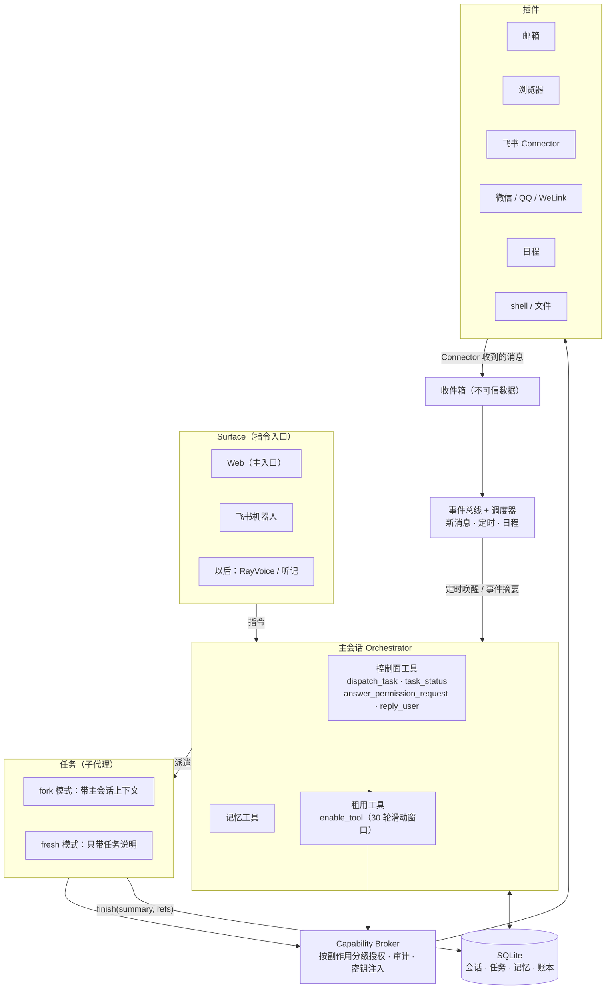

# 架构总览

> 版本 v0（2026-11-22，设计阶段）。架构图随版本演进，旧版本保留在 git 历史中。

## 模块与对应 ADR

| 模块 | 职责 | ADR |
|---|---|---|
| 运行时 | 基于 pi-durable 的会话、任务、持久化 | [0001](../adr/0001-build-on-pi-durable.md) |
| 主会话 | 唯一对话入口，派任务，租用高频工具 | [0002](../adr/0002-main-session-control-plane-and-leases.md) |
| Surface / Connector | 区分指令与数据 | [0003](../adr/0003-surface-vs-connector.md) |
| Capability Broker | 统一能力清单与三档权限 | [0004](../adr/0004-capabilities-and-permission-tiers.md) |
| 记忆 | 分层记忆与强制任务账本 | [0005](../adr/0005-memory-and-task-ledger.md) |

## 主动功能（设计中）

| 类别 | 例子 |
|---|---|
| 目标驱动 | 用户最近要考试 → 搜往年题 |
| 收件分诊 | 邮箱、微信、GitHub 通知里有没有重要的事 |
| 动态监看 | 关注的仓库、黑客松、话题有无更新 |
| 时间驱动 | 日程提醒，截止日前倒推准备 |
| 跟进 | 交代的事未完成、对方未回复、PR 无人 review |

通知分三级：立即打扰 / 每日摘要 / 静默记录；有安静时段与每日主动 token 预算。

核心指标是**打扰精准率**：推送给用户的内容中，用户认为有用的比例。漏斗：触发 → 预过滤 → 推送 → 打开 → 采纳。
